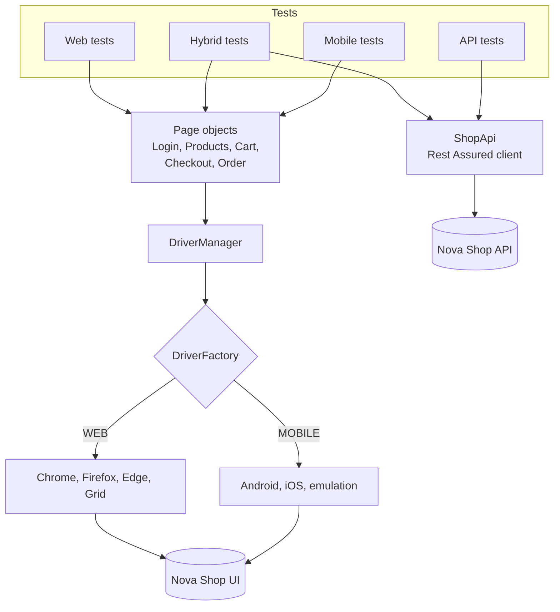

<div align="center">

# 🧩 Master Framework: Web, API and Mobile

**One framework for every layer of Nova Shop, with hybrid tests that check the UI against the API**

     

[](https://github.com/skamirullah/practiceqa-master-framework/actions/workflows/ci.yml)  

[What it tests](#-what-it-tests) · [Quick start](#-quick-start) · [How it is built](#-how-it-is-built) · [Structure](#-project-structure) · [Reports](#-reports-and-debugging)

</div>

---

## 👋 Overview

An all-in-one automation framework for an online shop. Web tests with Selenium, API tests with Rest Assured and mobile tests with Appium share one codebase, one configuration and one set of page objects. Hybrid tests build a cart in the browser and confirm the totals against the pricing API.

|  |  |
|---|---|
| **App under test** | [Nova Shop](https://www.practiceqaautomation.com/shop), an online store, and its [pricing API](https://www.practiceqaautomation.com/api-practice) |
| **Kind of testing** | Web UI, API, mobile web and hybrid |
| **Tests** | 26 tests |
| **Runs in** | Desktop browsers, Android, iOS or phone emulation |

### Highlights

- **Three layers, one project.** Run them together or one at a time.
- **Page objects reused on mobile.** The same classes drive a desktop browser and a phone.
- **Hybrid tests.** The cart on screen must show exactly what the API calculates.
- **Layered CI.** API, web and mobile run as separate parallel jobs.

## 🎯 What it tests

| Area | What is checked |
|---|---|
| Web: sign-in | Successful sign-in and four ways it is refused (data-driven) |
| Web: catalogue | Search, sort by price, sold-out marker, cart badge |
| Web: checkout | Purchase with a coupon, order ID; unknown coupon rejected |
| API: catalogue | Products, unique ids, published pricing rules |
| API: quote | Totals add up, express shipping, five rejected carts (data-driven) |
| Hybrid | Subtotal, discount, tax and total on screen equal the quote API |
| Mobile | Sign-in, locked-out account, search and a full purchase on a phone |

## 🚀 Quick start

**You need:** Java 17+ and Maven 3.9+. Chrome for web and emulation. Appium only for real devices.

```bash
git clone https://github.com/skamirullah/practiceqa-master-framework.git
cd practiceqa-master-framework
mvn test
```

| Command | What it does |
|---|---|
| `mvn test` | Run all layers: API, then web, then mobile |
| `mvn test -Dsuite=testng-api.xml` | API tests only (no browser) |
| `mvn test -Dsuite=testng-web.xml` | Web and hybrid tests, in parallel |
| `mvn test -Dsuite=testng-mobile.xml` | Mobile tests in phone emulation |
| `mvn test -Dsuite=testng-mobile.xml -Dplatform=android` | Mobile tests on an Android device through Appium |
| `mvn test -Dsuite=testng-smoke.xml` | Smoke tests from every layer |
| `mvn test -Dbrowser=firefox` | Web tests in Firefox (or `edge`) |
| `mvn allure:serve` | Open the Allure report |

> **Tested so far:** web, API, hybrid and mobile-emulation suites all pass. The Android and iOS configurations follow Appium's documented options but have not yet been run on a device from this repo.

## 🧱 How it is built



- **`Target` decides the driver.** `WebTest` and `MobileTest` differ in one line; everything else is shared in `UiTest`.
- **One factory.** `DriverFactory` starts desktop browsers, Appium sessions and phone emulation, all returned as `WebDriver`.
- **API client used twice.** `ShopApi` serves the API suite and gives hybrid tests their expected values.
- **Suites per layer.** `testng-api.xml`, `testng-web.xml` and `testng-mobile.xml`, combined by `testng.xml`.
- **Rate-limit back-off.** The quote client retries a 429 after a pause.
- **Selenium pinned with its BOM** so the Appium client and the browser drivers always match.

## 📁 Project structure

```text
src
├── main/java/com/practiceqa/novashop
│   ├── api/                        # ShopApi, CartItem, Quote
│   ├── driver/                     # Target, DriverFactory, DriverManager
│   ├── pages/                      # BasePage, LoginPage, ProductsPage, CartPage, CheckoutPage, OrderPage
│   ├── data/                       # Shopper, Card, Catalogue
│   └── config/Config.java          # settings from -D flags, env vars, then config.properties
└── test
    ├── java/com/practiceqa/novashop
    │   ├── base/                   # UiTest, WebTest, MobileTest
    │   ├── listeners/TestListener.java
    │   └── tests
    │       ├── web/                # Login, Catalogue, Checkout
    │       ├── api/                # CatalogueApi, QuoteApi
    │       ├── hybrid/             # CartMatchesApi
    │       └── mobile/             # MobileShopping
    └── resources/config.properties
testng.xml                          # all layers
testng-api.xml · testng-web.xml · testng-mobile.xml · testng-smoke.xml
```

## ⚙️ Configuration

Defaults live in `src/test/resources/config.properties`. Override any of them on the command line (`-Dbrowser=firefox`) or with an environment variable (`BROWSER=firefox`); nothing needs editing to change environment.

| Setting | Default | What it does |
|---|---|---|
| `base.url` | the live site | Site and API host. |
| `browser` | `chrome` | Web: `chrome`, `firefox` or `edge`. |
| `headless` | `true` | Set to `false` to watch the browser. |
| `grid.url` | empty | Web: Selenium Grid or cloud hub URL. |
| `platform` | `emulation` | Mobile: `android`, `ios` or `emulation`. |
| `appium.url` | `http://127.0.0.1:4723` | Mobile: Appium server. |
| `device.name` | `Pixel 7` | Mobile: device or simulator name. |
| `timeout` | `15` | Seconds to wait for an element before failing. |

## 📊 Reports and debugging

- **Allure**: run `mvn allure:serve` after a test run for a report with steps, timings and attachments. API requests and responses are attached.
- **UI failures** attach a screenshot and the page URL.
- **Surefire**: `target/surefire-reports/` holds the TestNG HTML and XML results.

## 🔁 Continuous integration

[GitHub Actions](.github/workflows/ci.yml) runs API, web and mobile as three parallel jobs on every push and pull request, so a failure names the layer it came from. Results are uploaded per layer.

## 🧪 About the app under test

Nova Shop is an online store with test accounts, search and sorting, a cart with coupons, tax and shipping rules, and a validated checkout. Its pricing API calculates a cart with the same maths as the UI, which is what makes the hybrid tests possible.

[PracticeQAAutomation](https://www.practiceqaautomation.com) is a free practice site for QA engineers, with realistic apps to automate with Selenium, Playwright and Cypress. All data in these tests is fictional.

## 👤 Author

**Sk Amir Ullah** · Technical Lead, SDET and Test Automation

[Portfolio](https://skamirullah.com) · [LinkedIn](https://linkedin.com/in/skamirullah) · [GitHub](https://github.com/skamirullah) · [PracticeQAAutomation](https://www.practiceqaautomation.com)

## 📄 License

[MIT](LICENSE)
